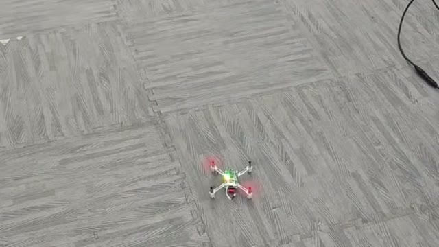
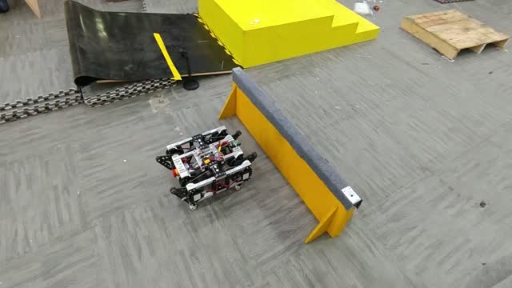
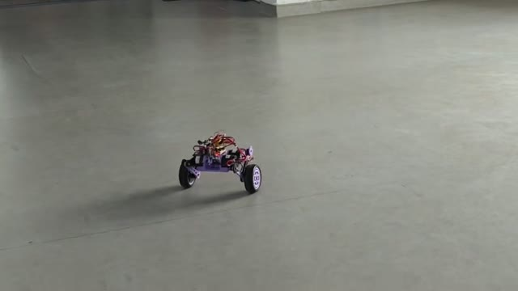
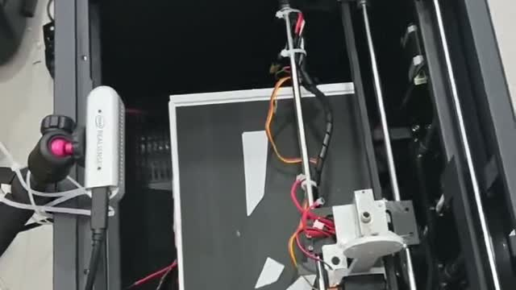
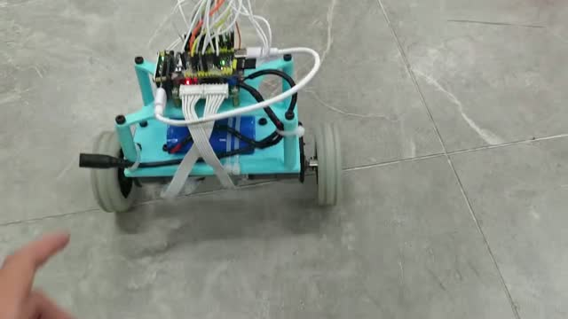
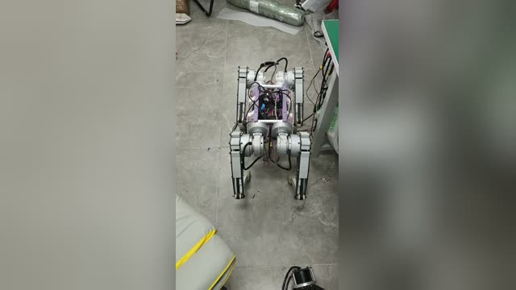

# 作品集 · Robotics Portfolio

机器人、嵌入式与运动控制相关作品的实机演示合集。视频按项目整理，点击预览图可查看完整片段。

## 演示

| 预览 | 项目 | 内容 | 时长 |
| --- | --- | --- | --- |
| [](videos/4轴飞行器.mp4) | 四轴飞行器 | 小型四轴飞行器室内低空悬停与移动。 | 15 s |
| [](videos/并联四足.mp4) | 并联四足 | 并联腿结构四足机器人行走并越过低矮障碍。 | 5 s |
| [](videos/达妙开源轮腿.mp4) | 达妙开源轮腿 | 轮腿机器人双轮平衡行驶与转向。 | 26 s |
| [](videos/电赛e题.mp4) | 电赛 E 题 | 二维滑台与执行机构联动，完成自动定位和运动控制。 | 20 s |
| [](videos/平衡车.mp4) | 平衡车 | 两轮自平衡小车的平衡保持与外力扰动后的恢复。 | 12 s |
| [](videos/rl四足.mp4) | RL 四足 | 强化学习策略驱动的四足机器人实机站立与转向。 | 53 s |

## 目录结构

```text
.
├── README.md
├── videos/          # 演示视频（H.264 MP4，可直接在线播放）
└── docs/thumbs/     # README 中使用的视频预览图
```

## 说明

- 本仓库仅包含演示视频，不含各项目的源码、图纸和模型文件。
- 视频由原始 HEVC 录制转码为 H.264（CRF 22，保留 AAC 音轨），以便在浏览器中直接播放；原始文件未改动。
- 除另有说明外，视频版权归作者所有，未经许可请勿转载。
